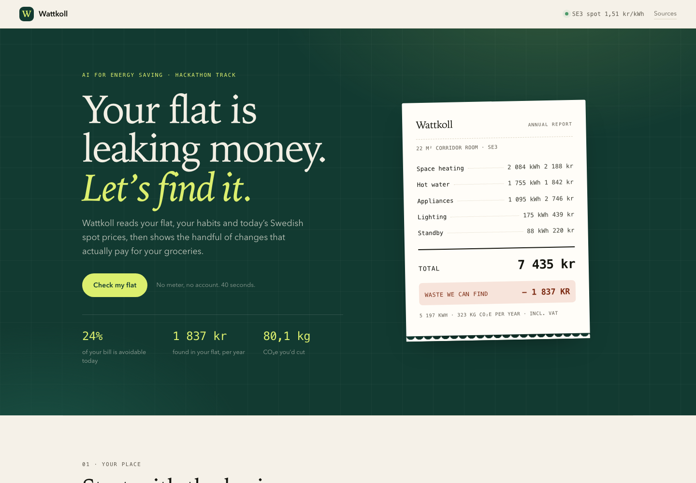

# Wattkoll

**Find where a student flat leaks energy — and what to do about it this week.**

Wattkoll is a working first version built for the *AI for Energy Saving* hackathon
track. A student answers a handful of quick questions about their flat, habits and
appliances; Wattkoll turns that into a full-year energy and cost baseline, a
ranked list of waste with kronor attached, and a plan they can actually finish.

No meter. No account. No personal data leaves the browser.



```
python3 server.py          # http://127.0.0.1:8000, opens your browser
```

Requires Python 3.10+ and nothing else. For the test suite: `node --test` (Node 18+).

---

## What it does

| Screen | What happens |
| --- | --- |
| **Receipt** | Annual kWh, SEK and CO₂e for the flat, broken down by end use — receipt-style, updates live. |
| **Your place** | Housing type, size, people, heating system, price area, tariff, shower length, indoor temperature, bulbs, appliances, draughts. |
| **The bill, taken apart** | Space heating / hot water / appliances / lighting / standby, with the biggest slice called out. |
| **What's leaking** | Waste detected from the answers, ranked by kr/year, each with a how-to and a payback time. Tick the ones you'll do. |
| **Cheap hours** | Today's real Swedish spot price curve (15-minute resolution), the cheapest four-hour window, and what load-shifting is worth per year. |
| **The coach** | Grounded answers about *your* numbers. Deterministic by default; plug in any OpenAI-compatible endpoint for free-form questions. |
| **The numbers** | The full per-student-per-year table (kWh / kr / kg CO₂e), assumptions and sources, editable carbon factors. |

## How the model works

Everything lives in `src/model.js` as pure functions — no DOM, no network — so the
UI, the tests and the documents all use the same numbers.

- **Space heating** = 90 kWh/m² useful demand (Stockholm, older multifamily) ÷
  system efficiency: district 0.95, direct electric 1.0, heat pump 2.8.
- **Hot water** = people × shower minutes × 9 L/min × 1.15 (taps etc.) × 50 K ×
  4.18 kJ/kgK ÷ boiler efficiency.
- **Appliances** = typical annual kWh per appliance (Energimyndigheten figures),
  **standby** = watts × 8,760 h.
- **Money** = spot price + grid/fees, × 1.25 VAT; or a fixed price if that is what
  the student has. District heating has its own price per kWh.
- **Waste** is detected by rules with a physical basis: 5% of heating per °C,
  blocked radiators 7%, windows ajar 6%, draughts 4% (capped at 35% of heating),
  shower time, halogen → LED, standby × 0.9, fridge 5% per °C below 5 °C,
  air-drying vs tumble dryer. Load shifting compares the 17–21 peak with the
  cheapest contiguous four hours of the day.
- **CO₂e** = 40 g/kWh electricity, 70 g/kWh district heat, both editable.

## Where the data comes from

- **Prices:** [elprisetjustnu.se](https://www.elprisetjustnu.se/elpris-api) — free,
  open, 15-minute spot prices per price area. The app fetches them through a tiny
  local proxy (the API sends no CORS headers) and caches for 30 minutes. A
  bundled snapshot (`data/prices-snapshot.json`) keeps the demo working offline.
- **Consumption:** Energimyndigheten household figures, SMHI climate normals,
  Electricity Maps / Stockholm Exergi for carbon intensity. Full list with links
  in the app's *Sources* panel and in `docs/SAVINGS.md`.

## Is the AI actually AI?

Honest answer: the **core model is a transparent expert system**, not a neural
network. That is a feature — a judge can check every number by hand.

The **coach** is where an LLM comes in. It receives the user's computed model as
JSON and answers in prose, and it is strictly grounded: it may not invent
numbers. Without an API key it falls back to a small intent router with
templated, number-grounded answers (also in `src/coach.js`), so the demo never
breaks on stage.

If we had a second day, the obvious next step is learning the waste priors from
real metered data (the organisers' synthetic dataset is the right shape) and
using the LLM to read the *rent notice and the appliance labels* instead of
asking the student to type them.

## Project layout

```
index.html            app shell
assets/app.css        design system
src/data.js           assumptions, appliance library, action copy, sources
src/model.js          the model: baseline, waste detection, price shifting
src/prices.js         live prices + offline snapshot
src/coach.js          grounded answers, optional LLM
src/app.js            UI: form, charts, plan, chat
server.py             static server + price proxy (stdlib only)
data/                 price snapshot, API cache
tests/model.test.mjs  12 tests over the model
docs/SAVINGS.md       the per-student numbers and where they come from
docs/BUSINESS.md      first business model
deck/                 5-minute pitch deck (Wattkoll-pitch.pptx + build script)
```

## Limits

- Estimates, not meter readings. Heating demand varies with building age and
  orientation; the model uses a Stockholm multifamily average.
- One price area, one day of prices in the demo — the savings table in
  `docs/SAVINGS.md` uses a typical-year spot price to avoid a single cold day
  dominating the numbers.
- District heating prices differ per landlord and are not in any open API, so
  they are an input with a sensible default.
- No personal data is collected, stored or sent anywhere. Settings live in
  `localStorage`; the LLM key, if used, goes only to the endpoint the user typed.
